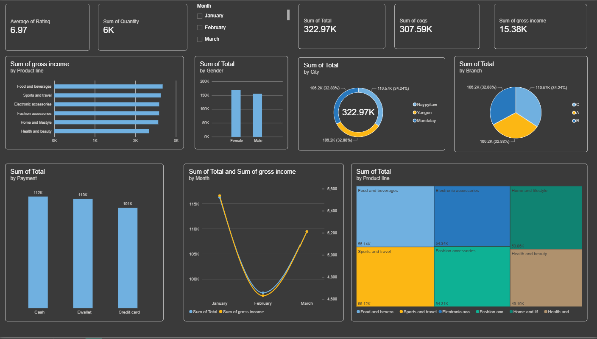

# 🛒 Supermarket Sales Dashboard — Power BI

An interactive **Power BI** dashboard analyzing three months of supermarket sales (January – March 2019) across three branches in Myanmar. The report gives a single-page view of revenue, profitability, customer behavior, and product performance to support data-driven retail decisions.



---

## 📌 Project Overview

| Item | Details |
|------|---------|
| **Tool** | Microsoft Power BI Desktop |
| **Dataset** | `supermarket_sales - Sheet1.csv` (1,000 transactions) |
| **Period** | January – March 2019 |
| **Branches / Cities** | A – Yangon · B – Mandalay · C – Naypyitaw |
| **Report file** | `super_market_sales.pbix` |

## 🎯 Objectives

- Track overall sales, cost of goods sold (COGS), and gross income.
- Compare performance across cities, branches, and product lines.
- Understand customer demographics and preferred payment methods.
- Identify monthly trends in revenue and profit.

## 📊 Key Metrics (KPIs)

| KPI | Value |
|-----|-------|
| 💰 Total Sales | **322.97K** |
| 📦 Total Quantity Sold | **~6K units** |
| 🏷️ Cost of Goods Sold | **307.59K** |
| 📈 Gross Income | **15.38K** |
| ⭐ Average Customer Rating | **6.97 / 10** |

## 📈 Dashboard Visuals

| Visual | Purpose |
|--------|---------|
| KPI Cards | Headline figures for sales, quantity, COGS, gross income, and rating |
| Month Slicer | Filter the whole report by January, February, or March |
| Bar Chart — Gross Income by Product Line | Rank product lines by profitability |
| Column Chart — Sales by Gender | Compare spending between female and male customers |
| Donut Chart — Sales by City | Revenue share per city |
| Pie Chart — Sales by Branch | Revenue share per branch |
| Column Chart — Sales by Payment | Popularity of Cash, E-wallet, and Credit card |
| Line Chart — Sales & Gross Income by Month | Monthly trend on dual axes |
| Treemap — Sales by Product Line | Relative contribution of each product category |

## 💡 Key Insights

- **Naypyitaw (Branch C)** leads in revenue with **110.57K (34.24%)**, while Yangon and Mandalay each contribute about **106.2K (32.88%)** — sales are evenly distributed across locations.
- **Food and beverages** is the top product line by both sales (**56.14K**) and gross income; **Health and beauty** is the lowest (**49.19K**).
- **Female customers** spend slightly more than male customers.
- **Cash (112K)** is the most used payment method, closely followed by **E-wallet (110K)**; **Credit card (101K)** is the least used.
- **January** recorded the highest sales, **February** dipped to the lowest point, and **March** recovered strongly — revenue and gross income move together.
- The average rating of **6.97** suggests room to improve customer satisfaction.

## 🗂️ Dataset Description

| Column | Description |
|--------|-------------|
| Invoice ID | Unique invoice identifier |
| Branch | Store branch (A, B, C) |
| City | Store location (Yangon, Mandalay, Naypyitaw) |
| Customer type | Member or Normal |
| BD Code / BD Name | Business developer code and name |
| Gender | Customer gender |
| Product line | Product category |
| Unit price | Price per unit |
| Quantity | Number of units purchased |
| Tax 5% | 5% tax on the purchase |
| Total | Total price including tax |
| Date / Time | Date and time of purchase |
| Payment | Cash, Ewallet, or Credit card |
| cogs | Cost of goods sold |
| gross margin percentage | Gross margin % |
| gross income | Gross income from the sale |
| Rating | Customer satisfaction rating (1–10) |

## 🛠️ Process

1. **Data import** — loaded the CSV into Power BI.
2. **Data cleaning & transformation** — checked data types, formatted dates, and extracted the month in Power Query.
3. **Data modeling** — built aggregated measures (Sum of Total, COGS, Gross Income, Average Rating).
4. **Visualization** — designed a dark-themed, single-page interactive dashboard with slicers and cross-filtering.
5. **Analysis** — derived business insights from the visuals.

## 📁 Repository Structure

```
Super-Market_Sales/
├── images/
│   └── dashboard.png              # Dashboard screenshot
├── super_market_sales.pbix        # Power BI report
├── supermarket_sales - Sheet1.csv # Raw dataset
└── README.md
```

## 🚀 How to Use

1. Clone the repository:
   ```bash
   git clone <repository-url>
   ```
2. Open `super_market_sales.pbix` in **Power BI Desktop**.
3. Use the **Month** slicer and click any visual to cross-filter the report.

## 👤 Author

**Ahmed Mohamad Youssef**
Data Analyst · Power BI

---

⭐ If you found this project useful, consider giving it a star!
